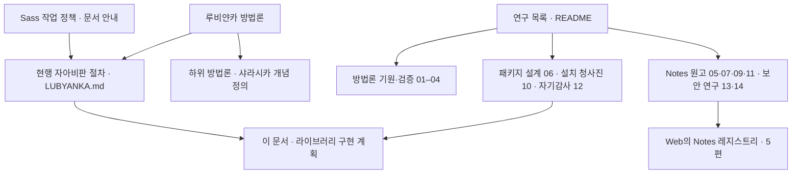
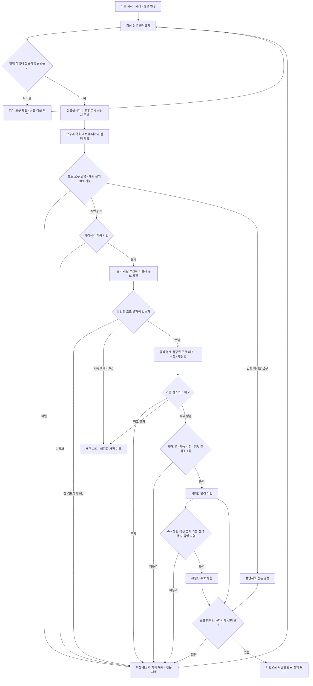

# 루비얀카 방법론 구성과 자아비판 라이브러리 구현 계획

2026-11-23 기준. 이 문서는 Control과 Web에서 확인한 문서·소스 구성과 독립 라이브러리의 구현 계획을 기록한다. 조사 기준은 Control `17a8c7d`와 Web `b58e8e5f`, 두 체크아웃의 작업 파일이다. 라이브러리 실행, 모델 호스트 연동, 운영 CMS 본문은 이번 조사 범위 밖이다.

[루비얀카·샤라시카 npm 구현 계획](LUBYANKA-SHARASHKA-IMPLEMENTATION-PLAN.md)에 초기 전제, 스킬·하네스·문서·스크립트·훅의 내부 계약, 격리 실행, 독립 판정, 패키지 검증 순서를 연결했다.

## Sass에서 조사한 문서 구성과 독립 저장소 안내

| 구분 | 문서와 역할 |
| --- | --- |
| Sass의 현행 규칙 | Sass 당시 `.agents/policy.md` → [이관한 자아비판 절차](../governance/LUBYANKA.md). 모든 지시와 질문의 전문 읽기, 정본문서·정답지 준비, 계획 근거 심사, 실패 시 재독과 재검증을 정의한다. |
| 하위 방법론 | [샤라시카](../governance/LUBYANKA.md#하위-방법론-샤라시카)는 샌드박스에서 계획과 코드를 시험한다. 계획 완료 후, 기능 완료 후 커밋 전, `dev` 병합 전에 적용한다. 완료·실패 보고에는 시험 근거가 필요하다. |
| 하위 방법론 참고 사례 | [온디바이스 STT](#샤라시카-참고-사례-온디바이스-stt)와 [HeavyMach 1·2 및 MachDefense 치트앱·계측](SHARASHKA-GAME-VALIDATION-CASES.md). |
| 기원과 연구 | [이관한 연구 목록](README.md)의 01–03은 하네스 비교, 방법론 정의, 기술 검증이다. 04 독립 감찰 연구는 Sass 원본의 연구 폴더에 남아 있다. 02는 자백서 작성과 다음 작업 전 재독의 출처를 기록한다. |
| 설명 원고 | 이관한 05·11은 서문·소프트웨어편이다. 이론편·인간편, 집필 계획, 보안 연구는 Sass 원본 연구 폴더에 있다. Web의 앱 본문은 별도 코드에 있다. |
| 패키지 설계 | [06 두 패키지](06_두_패키지_아키텍처_설계_2026-07-13.md)는 방법·실행기·스택 어댑터를 구상한다. [10 스캐폴드](10_공통_스캐폴드_lubyanka_init_청사진_2026-07-13.md)는 `lubyanka init`의 뼈대를 다룬다. [12 자기감사](12_방법론_자기감사_시운전로드맵_2026-07-13.md)는 재독 강제와 설치 절차를 미검증·미구현 항목으로 기록한다. |

## 코드에서 확인한 구현 범위

| 위치 | 확인한 동작과 상태 |
| --- | --- |
| Web Notes 데이터 `src/entities/content/notes-lubyanka.ts`·다국어 연결 `src/entities/content/notes-localized.ts` | `NOTES_SERIES`에 들어가기·이론·인간·소프트웨어·보안편이 등록돼 있다. `getNotesIssue`가 표시할 본문과 표지를 반환한다. 소프트웨어편에 재독을 설명하는 본문이 있다. |
| Web 읽기 경로 `src/app/notes/[slug]/page.tsx`·공유 경로 `src/app/n/[slug]/page.tsx` | `/notes/{slug}`는 쇼케이스에 해당 편을 연다. `/n/{slug}`는 공유용 본문 경로다. 코드에는 등록 콘텐츠와 게시본을 읽는 경로가 있다. Control의 자아비판 절차는 이 콘텐츠 경로와 별도로 관리한다. |
| Control·Web의 과거 하네스 | Control의 기준 Git 트리에 남은 `.agents/harness/cli.mjs`는 `doctor/plan/check`를 제공했다. `scripts/harness/record-sync-incident.mjs`는 저장소 동기화 사건을 기록했다. 두 작업 트리에서는 기존 하네스 제거가 진행된 상태다. 삭제 상태를 Git과 대조했고, 당시 제거 근거는 Control 작업 트리의 `governance/audits/2026-11-10-docs-only.md`에서 확인했다. |
| 자아비판문과 설치 코드 | Control의 `LUBYANKA.md`와 작업 정책은 문서로 존재한다. 조사한 두 체크아웃의 패키지 진입점에서 독립 `lubyanka` 패키지, `lubyanka init` 실행기, 최신 전문을 현재 AI 요청에 주입하고 도구 접근을 제어하는 코드를 확인하지 못했다. |
| 다른 프로젝트의 적용 사례 | ProjectSendPrLetterAddr의 `AGENTS.md`는 회사 배치 자아비판문을 착수 전 필독으로 지정한다. 그 프로젝트의 `local_validation_guard.py` 계열은 localhost 검증을 다룬다. 자아비판문 전문을 전달하고 읽기를 강제하는 독립 라이브러리의 증거는 이 사례에서 확보하지 못했다. |

## 샤라시카 참고 사례 온디바이스 STT

같은 로컬 Git 폴더에 있는 `ProjectSTT_OnDevice`의 커밋 `3fad8cc`에서 소스와 보존된 실험 기록을 확인했다. 격리된 재현 조건에서 관측을 의심하고 경계 동작을 검증한 샤라시카 참고 사례다. 현행 적용 시점은 [샤라시카 필수 시험](../governance/LUBYANKA.md#샤라시카-필수-시험)을 따른다.

- **실사용 경로를 시험실로 가져왔다.** iPhone에서 스피커를 통해 받은 47분 녹음에 원본 발화에 없는 문장이 22회 나왔다. 같은 녹음을 맥 CLI에 실시간으로 공급해 환각 25건과 겹치는 발생 시점을 관찰했다. 파일 입력과 마이크 경로 모두 실제 청크 처리 코드의 `setupChunkLive`를 호출한다. 문자 오류율(CER)은 폰 0.378, 맥 0.376이었다. 근거는 `research/stt-engine-benchmark.md` §2.1-A·A-c와 `stt-ios/WhisperSTTKit/Sources/WhisperSTTKit/WhisperKitEngine.swift`다.
- **계측기가 만든 0건을 찾아냈다.** 첫 비교에서 음성 끝을 감지하는 기능을 끄자 환각이 0건이었다. 그 실행의 바이너리에 새 출력 필터가 들어 있어, 환각이 발생하지 않은 경우와 발생한 뒤 출력에서 삭제된 경우를 구별할 수 없었다. 같은 바이너리에서 클로징 문구 삭제만 끄고 다시 비교하자, 끝 감지를 끈 조건의 환각은 26건에서 6건으로 줄었지만 CER은 0.371에서 0.426으로 악화됐다. 청크 상한을 6초에서 8초로 늘리고 끝 감지를 유지한 조건은 CER 0.331, 환각 25건이었다. 근거는 벤치마크 §2.1-A-d·A-e, 측정용 변경 `476ae34`, 실측 `d27cd23`이다.
- **방어가 지켜야 할 경계와 제품 판정을 남겼다.** 필터 회귀 테스트는 환각 형태의 문구를 제거하는 경우와 비슷한 표현이 포함된 실제 발화를 보존하는 경우를 함께 다룬다. 8초 설정의 아이폰 지연 검증은 완료 전에 프로젝트가 종결돼 기본값 변경으로 이어지지 않았다. 근거는 `stt-ios/WhisperSTTKit/Tests/WhisperSTTKitTests/LiveTextSanitizeTests.swift`와 `PROGRESS.md` §11이다.

Android에서도 빌드가 계측에 영향을 준 기록이 있다. 초기 속도 측정은 엔진이 디버그 `-O0`로 빌드된 상태였고 실제 마이크 전사에서 앱이 중단됐다. 엔진에도 최적화가 적용되도록 CMake를 수정한 뒤 실기기에서 마이크 녹음부터 전사·웹뷰 전달까지 확인했다. 초기 속도 수치는 벤치마크에서 무효로 분리했다. 근거는 `stt-android/docs/architecture.md` §2.6과 벤치마크 §2.2다.

## Gemini의 2단 구조 제안

사용자가 전달한 Gemini의 당시 제안 원문이다. 현행 적용 시점은 [샤라시카 필수 시험](../governance/LUBYANKA.md#샤라시카-필수-시험)을 따른다.

> 루비얀카 방법론 (상위 철학 · 검증 게이트): *"AI의 초안은 기본적으로 유죄다"*라는 불신 원칙 아래, 실패 은폐나 조기 퇴근을 막고 기준선(Baseline)과 증거(diff·로그)로 결과물을 심사하는 감사·반려 계층. 샤라시카 방법론 (하위 실행 모드 · 격리 연구소): 단순 수정이 아니라 레거시 게임 복원이나 대규모 배치 최적화처럼 난도가 높은 작업에 투입하는 격리 실행 계층. 에이전트를 독립된 작업 공간(별도 브랜치·컨테이너)에 가둬두고, 명확한 목표 수치와 자동 계측 도구, 인접 레퍼런스 코드를 함께 넣은 뒤 실제 로켓이 뜨는 것(테스트·지표 통과)이 확인될 때까지 밖으로 못 나오게 돌리는 구조. / 샤라시카가 루비얀카의 '더 독한 버전'이 되어서는 안 된다는 점입니다. 역사적으로 샤라시카가 실제로 항공기와 로켓을 만들어낼 수 있었던 이유는 루비얀카보다 더 세게 고문해서가 아니라, 반대로 무의미한 이념 심문을 멈추고, 격리된 공간 안에서 실제 연구 장비와 명확한 공학적 목표를 쥐여주었기 때문입니다.
> 따라서 코드로 옮길 때도 루비얀카(엄격한 유죄 추정과 반려)가 바깥의 문지기를 맡고, 샤라시카(격리된 환경 + 풍부한 도구 + 객관적 통과 기준)가 안쪽의 실제 문제 해결을 맡는 2단 구조로 설계해야 비로소 '화풀이'가 아니라 진짜 궤도에 오르는 프레임워크가 됩니다.

## 독립 라이브러리의 첫 구현 범위

TypeScript 코어와 얇은 CLI를 별도 패키지로 만든다. 첫 작동 예제는 격리된 테스트 프로젝트에 설치한다. 호스트 한 종류와 연결해 전문 전달 및 도구 제한을 검증한 뒤 다른 호스트로 넓힌다. 기존 두 패키지 구상에서 이 계획은 개발 도중 동작하는 루비얀카 패키지에 속한다.

| 구성 | 맡을 일 |
| --- | --- |
| 설치 CLI | `lubyanka init`에서 공통 자아비판문과 선택적인 경로별 문서의 위치를 설정한다. 기존 Markdown을 그대로 연결하거나, 선행 문서가 없으면 기준·가정·근거·전후 결과를 기입할 틀을 생성한다. 기존 지침에는 연결만 추가하고 요구와 판정 기준은 프로젝트가 정한다. 재실행 시 기존 파일·문장 보존을 확인한다. |
| 문서 로더 | 프로젝트 루트와 담당 경로로 공통 문서와 해당 경로 문서를 찾는다. 본문 전문, 경로, 내용 해시를 현재 작업에 돌려준다. 정본 누락, 읽기 실패, 프로젝트 밖 경로, 전문이 들어갈 수 없는 컨텍스트는 이유와 함께 반환한다. 작업 도중 유효 범위가 넓어지면 새 경로의 전문도 먼저 전달한다. |
| 작업 상태와 호스트 연결 | 각 지시와 질문의 전문 전달, 정본문서·정답지 준비, 계획 근거 판정을 연결한다. 개발에는 샤라시카의 계획·기능·병합 시험을 적용한다. 완료·실패 보고에 해당 범위의 실제 시험 근거를 요구한다. |
| 증거 비교 | 실행 시각·버전·입력·기준·원본 산출물 참조를 받는다. 같은 입력·환경·판정 기준에서 시간, 정확도, 행별 출력값과 누락을 각각 비교한다. 기준이 바뀐 결과를 비교 불가로 표시한다. 입력·분모·오류 기준은 프로젝트가 정한다. |
| 발견 사항과 기록 갱신 | 구현자가 검토한 가정, 코드 위치, 재현 입력, 기대값과 실제값을 기록한다. 확인한 결함과 미확인 의심을 구분한다. 병렬 작업에서 자아비판문을 갱신할 때 읽은 버전과 현재 버전이 다르면 최신본을 다시 읽고 근거를 반영한다. 본문과 원본 근거는 프로젝트에 보관한다. |

## 자아비판문이 동작하는 순서

- 전문 전달과 [계획 판정](../governance/LUBYANKA.md#90-착수-기준)은 본 작업의 조사·수정·검사와 응답에 앞선다. 문서·작업 범위가 바뀌거나 후속 지시를 받으면 이전 판정을 재사용할 수 없다. 정본 접근 실패는 읽기 단계에서 해결한다.
- 측정의 후퇴는 비교 결과로 감지한다. 결함 미발견은 작업자가 검토 단계에 제출한 코드 위치·재현·증거를 확인한 뒤 판정한다. 첫 검토의 확인 결함이 0건이면 이전 무결함 판단을 철회하고 재독을 먼저 요구한다. 재독 후에도 증거가 없으면 확인 범위와 미검증 가정을 남긴다. 이미 증거로 확인한 결함을 고친 뒤에는 같은 실패 경로의 재실행과 후퇴 여부로 수정 결과를 판단한다.
- 라이브러리는 최신 전문·정본·정답지 버전과 계획의 근거를 확인하도록 설계한다. 핵심 선택을 바꾼 지적을 확인하고, 계획·커밋·병합·보고 범위의 실행 기록을 각각 대조한다.

## 구현 순서와 통과 기준

| 순서 | 구현과 통과 기준 |
| --- | --- |
| 1. 문서와 상태 코어 | 기존 정본 보존과 누락 보강, 정답지 준비, 전문 누락·부분 전달·구버전과 이전 판정 무효화를 검사한다. 근거가 조치를 바꾼 계획과 관련 문구만 인용한 계획의 판정이 갈리는지 확인한다. |
| 2. 실제 호스트 한 종류 | 새 지시·단순 질문·재개에서 전문 전달·정본 준비·계획 심사 순서를 관측한다. 미달 및 필수 시험 기록 누락에서 본 작업·커밋·병합·보고가 단계별로 막히는지 확인한다. |
| 3. 자아비판과 샤라시카 한 주기 | 첫 행이 느린 회사 배치를 계획 시험에서 재현한다. 기능 커밋 전 시험에서 수정의 착수·저장·엑셀 결과를 검증하고, 병합 후보에서 여러 기능을 동시에 실행해 전체 출력을 비교한다. 필수 시험 실패와 `dev` 변경에서 재독·재시험이 필요한지 확인한다. |
| 4. 라이브러리 배포 준비 | 깨끗한 별도 프로젝트에서 패키지 설치·명령 실행·기존 파일 보존을 확인한다. 코어 API, 호스트 연결 책임, 지원 환경과 대체 절차를 문서화한다. 실제 호스트에서 검증한 범위로 지원 상태를 표시한다. |

이관된 규칙과 실제로 검증한 자동화 범위는 [독립 검증 기록](../verification/README.md)에서 확인한다.
