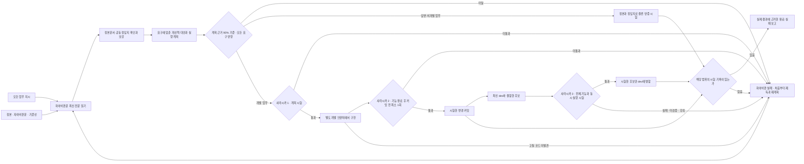

# 루비얀카·샤라시카 npm 구현 계획

2026-11-23 설계안. 시작점은 [두 방법론의 공통 서문](../governance/LUBYANKA.md#루비얀카와-샤라시카의-서문), [초기 방법론과 검증 원칙](02_루비얀카_방법론_규명과기획_2026-07-13.md), [기존 패키지 설계](06_두_패키지_아키텍처_설계_2026-07-13.md), [Gemini의 두 계층 제안](LUBYANKA-LIBRARY-PLAN.md#gemini의-2단-구조-제안)이다. 여기서 제안하는 구현 순서와 적용 단계는 설계안으로 기록한다. 사용자에게 별도 npm 계정이 있다. 사용할 스코프·저장소·게시 방식은 배포 단계에서 확인한다.

## 제품 구조

TypeScript 코어와 CLI를 독립 개발 저장소의 **npm 패키지 하나**로 시작한다. 표기 `@<scope>/lubyanka`는 후보 이름이다. 샤라시카는 같은 패키지에서 별도 실행 모드로 제공한다. 초기 루비얀카가 구상한 **외부 배포 감찰**은 독립 책임으로 유지한다. 이번 npm 패키지가 해당 권한을 소유하지 않는다. 첫 설치는 합성 재현 프로젝트에서 한다. Sass의 기존 개발 지침과 호스트 설정은 이 설계의 설치 대상으로 삼지 않는다.



## 초기 전제를 코드에서 지키는 방법

| 초기 전제 | 구현 계약 |
| --- | --- |
| AI와 인간이 짠 코드 모두 유죄추정에서 시작한다. | 작성자의 완료 선언·리뷰 칭찬·기존 테스트 개수만으로 합격 상태를 만들 수 없다. 요구사항과 원본 증거가 확인한 범위만 판정한다. |
| 정답의 기준은 사용자 요구와 도메인에 있다. | 사용자가 준 요구·결과·보존 조건을 작업 시작 전에 고정한다. 라이브러리는 문서 틀과 참조를 생성한다. 모르는 도메인 기준, 제한 시간, 목표 점수는 빈칸이나 미정으로 남긴다. 모델이 더 쉬운 합격 기준을 선택하면 기존 작업의 합격 근거로 사용하지 않는다. |
| 요약보다 원본, 교차검증 전 완료 없음. | 검사 실행기가 실제 명령의 종료 상태와 원본 결과를 보관하고, 독립 검증기가 현재 후보에 다시 실행한다. 테스트가 있어도 실행 결과가 없거나 필수 항목 수가 맞지 않으면 미검증이다. 기존 근거는 입력·환경·버전과 영향 범위가 일치하는 경우에만 재사용한다. |
| 실수는 자아비판문을 쓰게 하고 다음 작업과 재독 조건에서 다시 읽힌다. | 작업 범위의 최신 전문을 도구를 열기 전에 전달한다. 고칠 코드가 없어 보이면 그 자아비판이 잘못됐다고 간주하고 즉시 전문을 다시 읽힌다. 어느 지표라도 악화돼도 재독으로 돌아간다. 재독 후 입증하지 못한 범위와 남은 가정은 미입증으로 기록한다. |
| 모든 지시와 단순 질문에서 전문을 먼저 읽고 정본문서와 정답지를 준비한다. | [90% 착수 기준](../governance/LUBYANKA.md#90-착수-기준)과 모든 사용자 요구 반영을 확인한다. 개발 업무는 계획 후·기능 커밋 전·병합 전의 [샤라시카 필수 시험](../governance/LUBYANKA.md#샤라시카-필수-시험)을 거친다. 근거 미달·시험 미통과·실행 기록 없는 종료는 이전 시도를 실패로 기록하고 전문을 처음부터 전달해 새 계획을 심사한다. |
| 작성자가 자신의 감시를 무력화할 수 있다. | 작업자는 제품 코드와 새 회귀 테스트를 바꿀 수 있다. 기준선·이미 합의한 판정·검증기 설정과 최종 판정의 쓰기 권한은 실행 측에서 분리한다. 검증기는 작업자가 낸 결론을 보지 않고 요구와 판정기로 먼저 검증한다. 후보와 함께 바뀐 테스트는 별도로 살피고 기준선의 독립 검사도 실행한다. |
| 느슨하면 근거 없는 통과, 과하면 백지와 절차 낭비가 생긴다. | 필수 전문과 현재 요구를 먼저 전달한다. 장기 기록의 각 사건은 원본 링크로 둔다. 변경 폭에 맞게 기능별 커밋 전 시험의 격리와 계측 깊이를 고른다. 병합 후보에는 전체 기능 시험을 적용한다. |

## 무엇을 추가하는가

이 표의 이름과 경로는 제안이다. 독립 패키지에 표준 템플릿을 넣고 도입 프로젝트가 소유할 문서·측정값을 구분한다.

| 구성 | 추가할 항목 | 내부에서 하는 일 |
| --- | --- | --- |
| 스킬 | `lubyanka-review`, `sharashka-lab`, `lubyanka-verification` | 리뷰 스킬은 전문 읽기, 사용자 요구 추출, 원문과 조치를 잇는 계획, 실패 시 재독을 다룬다. 연구실 스킬은 재현 입력·작업 범위·계측·원복 가능한 후보를 다룬다. 검증 스킬은 요구와 실제 산출물·독립 실행 결과를 대조한다. 스킬은 증거를 만드는 방법을 안내하고 도구 권한이나 합격을 발급하지 않는다. |
| 문서 | `AGENTS.md`/`CLAUDE.md`의 관리 구간, `docs/lubyanka/contract.md`, `self-critique.md`, `cases/`, `lab.md` | 작업 지침에는 필독 정본과 재독 조건을 연결한다. 계약은 사용자가 원하는 결과·보호 범위·플랫폼 요구를 보관한다. 자아비판문은 실패한 판단·재현·수정·후속 관측을 사람도 읽을 수 있게 쓴다. 긴 사건의 원본은 `cases/`에서 연결한다. `lab.md`는 연구실의 허용 작업, 입력과 참고 소스, 종료에 필요한 검사를 프로젝트별로 적는다. |
| 기계 입력 | 프로젝트의 `lubyanka.json`과 버전이 붙은 JSON Schema | 필독 문서 경로, 스택 어댑터, 기준선·시나리오 ID, 읽기/쓰기 범위, 필수 검사와 기대값 참조, 결과 비교 방향·단위를 담는다. 초기화가 도메인 수치나 계정 정보를 추측해 넣지 않는다. 사람 문서와 다른 판정 조건을 따로 운영하지 않도록 모든 기계 항목에 요구 ID를 붙인다. |
| 하네스 | `contracts`, `documents`, `gate`, `evidence`, `lab`, `adapters` | 문서 로더, 작업 상태, 증거 저장, 결정론 비교, 격리 실행, 호스트 연동을 나눈다. `gate`는 근거와 작업 상태에서 허용/재독/반려를 결정한다. `lab`에서 직접 상태를 합격으로 바꿀 수 없다. `adapters`는 제품의 CTest·XCTest·Node 테스트와 이미 존재하는 계측을 호출한다. |
| 스크립트/CLI | `init`, `doctor`, `start`, `verify`, `submit`, `lab start`, `lab status`, `lab export` | `init`은 계획을 미리 출력하고 명시적으로 적용할 때 연결을 추가한다. `doctor`는 도구·경로·호스트 범위와 실제 검증 모드 지원 여부를 확인한다. `start`는 전문과 기준선을 준비한다. `verify`는 대상 명령과 원본 증거를 수집한다. `submit`은 독립 판정을 요청한다. `lab export`는 심사할 diff와 실험 자료를 제출용으로 내보낸다. 이 명령들의 성공을 제품 검사 통과로 해석하지 않는다. |
| 훅 | 호스트별 `SessionStart`, `UserPromptSubmit`, `PreToolUse`, `PostToolUse`, `Stop`; 필요한 경우 압축·이어받기 이벤트 | 시작·새 업무에서 필독 내용을 전달하고, 도구 전에는 현재 작업 상태를 조회한다. 성공/실패·원본 경로는 도구 뒤에 관측한다. 종료 시 현재 판정 상태와 남은 검사를 전달한다. 모든 훅은 같은 코어를 부르는 얇은 어댑터다. 이벤트마다 호스트 고유 응답 형식을 사용한다. |

패키지 공개 모듈은 `core`, `reports`, `sharashka`로 시작하고 CLI와 호스트 어댑터가 같은 코어 함수를 호출한다. 호스트 셸 명령은 등록한 실행 파일과 인자 배열로 전달한다. 초기화는 기존 프로젝트 지침을 안전하게 덧붙이고 재실행해도 중복 장치가 생기지 않게 한다. npm 설치 스크립트에서 프로젝트나 전역 훅을 활성화하지 않는다.

```text
src/
  core/          사용자 계약 · 문서 로더 · 작업 상태 · 판정 규칙
  evidence/      실행 기록 · 원본 참조 · 버전 대조 · 보고서
  sharashka/     격리 드라이버 · 시험 저장 · 후보 자료 내보내기
  adapters/      Codex/Claude 호스트 · 실제 제품 검사 도구
  cli/           설치 · 작업 실행 · 검증 및 심사 요청
templates/       방법론 템플릿 · 스킬 · 호스트별 훅 구성
test/            상태 전이 · 호스트 통합 · 합성 재현 · 패키지 설치
```

## 내부 계약과 실행

[정답지 전제와 판정 기준 연구](LUBYANKA-SHARASHKA-ORACLE-RESEARCH.md)는 사용자 지시에서 판정기를 만드는 방법, 라이브러리가 독립 근거로 보완할 범위, 판정 근거와 이전 실측 기준선의 차이를 다룬다.

[독립 스캐폴드](oracle-scaffold/README.md)는 정답지·자아비판문 양식 생성, 파일 변경 대조, CLI 텍스트와 채팅용 JSON 종료 안내를 제공한다. 담당 AI는 정본과 정답지를 직접 확인·작성·보강한다. 전문 전달, 계획 심사, 샤라시카 시험, 커밋·병합·보고 차단과 채팅 알림의 자동화는 후속 구현이다.

2026-11-24에 Node 검사 10개를 실행했다. 오프라인으로 설치한 패키지에서 주소 수집 프로젝트의 기존 자아비판문을 복사해 사용했다. 착수에서 정답지만 생성했고, 두 문서를 수정한 뒤 CLI와 JSON에서 변경을 확인했다. 사용자 기준인 119/120과 이전 실측 90/120을 각 근거와 연결했다. 시험 범위는 문서 처리였으며 제품의 이번 적중률은 미판정으로 출력됐다.

### 독립 저장소 분리 전 검증

- 기준 커밋 `b2349cb`에서 기존 검사 12개가 통과했지만, 오프라인 설치본으로 재현하니 `start --oracle`로 지정한 JSON 정답지를 `check`에 넘길 수 없었다. 손상된 JSON으로도 착수 기록을 만들었다. 정답지를 여는 경로와 구조 검사를 명령 사이에 공유하고, 손상된 파일과 입력을 채워야 하는 정상 양식을 구분했다. 파일을 연 핸들에서 일반 파일 여부를 확인한 뒤 그 핸들로 읽는다. [Node.js 파일 핸들](https://nodejs.org/api/fs.html#class-filehandle)
- 독립 저장소의 초기 소스 범위는 패키지 소스·검사와 [방법론 정본](../governance/LUBYANKA.md), [정답지 연구](LUBYANKA-SHARASHKA-ORACLE-RESEARCH.md), 구현 계획이다. 분리 시 정본의 상대 링크와 사례의 원본 참조를 새 경로에 맞춘다. 설치용 tarball에는 CLI·템플릿·README·패키지 설정이 들어간다.
- 현재 `finish`는 문서 검토 기록을 출력한다. 격리 설치본에서도 미판정 정답지와 샤라시카 실행 근거가 없는 기록으로 이 출력을 받을 수 있다. `verify`와 샤라시카 실행 명령, 라이브러리 API는 아직 구현하지 않았다. 독립 저장소의 개발용 초안으로 분리할 수 있으며, 전체 방법론을 강제하는 npm 릴리스에는 아래 통과 기준을 적용한다. 현재 패키지의 `private: true`는 공개 게시를 차단한다. [npm 패키지 게시 보호](https://docs.npmjs.com/cli/v11/configuring-npm/package-json/#private)

### 1. 작업 범위, 읽기, 계획 판정

- `startTask(request, projectScope)`는 작업 ID, 승인된 요구 ID, 기준 커밋, 보존 경로, 필독 문서 목록, 기준선 참조를 만든다. 이 입력은 검증기가 읽는 영역에 둔다. 변경이 필요하면 새 기준으로 기록하고 이전 판정과 섞지 않는다.
- `loadRequiredDocuments(task, scope)`는 프로젝트 공통 자아비판문과 해당 경로의 별도 자아비판문을 읽어 전문·경로·해시를 반환한다. 로더는 경로가 프로젝트 밖으로 빠지는지 확인한다. 호스트가 실제 요청에 전달한 작업 ID, 시도 번호, 본문 해시와 길이를 기록한다. 결과에 비밀이나 전문을 중복 저장하지 않는다.
- 전문을 전달한 뒤 업무 지시와 단순 질문 모두에서 작업 범위의 정본문서와 공동 정답지를 확인한다. 사용자 요구·보존 조건·근거 출처·입력·기대 결과·관측 지점의 누락을 찾아 작성·보강한다. 두 문서의 현재 버전을 계획과 관련 시험에 고정하고 미확정 값에 의존하는 작업을 보류한다.
- 검증기는 계획의 핵심 조치마다 자아비판문 원문, 적용 조건, 원문으로 달라진 선택·대안·검증 방식, 판단을 뒤집을 관측을 확인한다. 각 판단의 근거가 현재 요구에 맞고 실제 결정을 뒷받침하는지 심사한다. 근거 품질 90% 미달 이유와 누락된 요구를 반환한다. 자동화는 원문·버전 대조와 근거 누락 감지부터 지원하며 실질적 관련성은 근거와 논증을 대조해 심사한다.
- `permitAction(task, action)`은 전문 전달, 정본·정답지 준비, 현재 계획 판정을 확인한다. 계획 심사 전에는 준비에 필요한 자료 확인·문서 작성·보강과 계획 작성·심사를 허용한다. 개발 브랜치의 구현은 샤라시카 계획 시험까지 통과한 뒤 연다. 새 지시·재개·정본이나 작업 범위 변경·재독에서 이전 허용을 무효화한다. 근거 미달과 샤라시카 미통과는 `읽기 필요`로 돌려보낸다. 사용자 중단은 즉시 적용한다.

개발 상태는 `읽기 필요 → 정본·정답지 준비 → 계획 심사 → 샤라시카 계획 시험 → 구현 → 샤라시카 기능 시험 → 커밋 → 샤라시카 병합 시험 → 병합 허용`으로 전이한다. 재독 조건이 생기면 이유를 남기고 `읽기 필요`로 돌아간다. 착수 판정은 현재 지시·시도·정본과 정답지 버전·범위·계획에, 커밋 판정은 시험한 후보 내용과 설정에, 병합 판정은 `dev`와 개발 브랜치의 정확한 커밋 및 시험 후보에 묶는다. 질문·비개발 업무는 정답지로 답변·산출물을 검증한다. 통제 실행기는 작업 도구, 커밋·병합, 완료·실패 보고 진입점에서 상태를 검사한다.

### 2. 독립 실행과 판정

- `captureBaseline()`은 소스·빌드·도구 버전, 판정 기준, 입력과 출력 해시, 실행 환경과 원본 결과를 함께 기록한다. 기존 기준선으로 비교할 수 없는 신규 기능은 합의한 기대값과 재현을 준비한다. 전후 성능을 잰 근거가 없으면 개선율을 산출하지 않는다.
- `verifyCandidate()`는 후보의 커밋 또는 변경 해시를 고정하고, 필수 요구별 정상·실패·경계 검사와 관련 회귀를 실제 실행한다. 프로젝트 도구의 종료 상태, 실행 건수, 원본 JSON·로그·영상·trace 참조를 수집한다. 실행 이후 후보나 기준이 바뀌면 영향을 받는 증거를 다시 얻는다. 기존 검사의 실행 건수가 0이거나 출처가 없는 요약은 통과 증거로 채택하지 않는다.
- `compareRuns()`는 요구별 상태, 값, 기준 분모, 시나리오 일치를 확인한다. 속도·정확도·산출물의 각 지표를 독립 비교한다. 평균과 개별 행·구간을 함께 본다. 외부 응답이나 추적기 등 측정 조건이 달라 원인을 가를 수 없으면 `비교 불가`로 남기고 같은 조건을 확보한다. 허용 오차와 반복 방식은 최초 계약에서 정한다.
- `recordFinding()`은 검토한 가정, 코드 위치, 실패 입력, 기대값과 실제값을 자아비판문에 연결한다. 외부 베스트 프랙티스의 출처와 적용 조건, 기존 코드가 왜 실패하고 제안한 방법이 왜 실패를 막는지에 대한 논증을 수정 전에 남긴다. 수정과 재시험을 같은 기록에 연결한다. 직접 만든 검사에서 성공을 보고한 작업자와 독립 결과를 발급하는 검증기는 별도 권한을 쓴다. 필요한 경우에만 다른 제공사의 모델을 검토에 추가한다. 모델 판단은 재현과 독립 증거를 대체하지 않는다. 서비스를 호출하는 키는 사용자가 가진 실행 환경에서 사용한다.
- `judge()`는 `검증 범위 통과`, `반려`, `미검증`을 판정한다. 샤라시카 필수 시험 미통과, 결과 후퇴, 고칠 코드 미발견은 자아비판 실패로 기록하고 전문 재독 단계로 돌려보낸다. 입증한 결함과 실행할 수 없었던 시험을 구분한다. 재독 후 이전에 생략한 입력·가정을 외부 베스트 프랙티스에 대조한다. 실제 실패를 확인하면 근거를 논증하고 고친 뒤 같은 경로와 필수 시험을 실행한다.

증거 묶음에는 요구 ID, 실행 ID, 명령과 대상 환경, 후보 SHA, 계약·기준선 해시, 각 필수 검사 이름과 실행 건수, 원본 파일 경로와 해시를 둔다. 원본은 실행기를 통해 확보해 작업자가 쓰는 후보 폴더 밖에 보관한다. 독립 판정을 발급할 때는 증거와 현재 제출 후보를 다시 대조한다. 수동 기기 확인은 관측자·판본·기기·시나리오와 원본 기록이 있는 실행으로 별도 표시한다.

### 3. 샤라시카 실행 모드

1. **계획을 시험한다.** 계획 수립이 끝나면 구현 전에 사용자 요구, 공동 정답지, 적용 정책, 기존 코드·기준선과 재현 입력을 고정한다. 샌드박스에서 핵심 가정을 재현하고, 시험 도구로 요구한 상태에 도달할 수 있는지와 어떤 결과가 계획을 기각하는지 확인한다. 결과에 계획 버전과 정답지 버전을 연결한다.
2. **커밋 전에 기능을 시험한다.** 기능이 완성되면 커밋에 들어갈 소스와 설정으로 샌드박스에서 최소 1회 실행한다. 그 기능과 영향받는 경로의 정책·경계·실패·복구를 확인한다. 시험한 내용이 바뀌면 재실행한다. 시험 결과에는 후보의 내용 지문과 실행 환경을 연결한다.
3. **병합 후보를 준비한다.** 개발 브랜치의 결과를 최신 `dev`와 결합해 시험 사본을 만든다. 대상·소스 커밋과 실제 시험한 후보를 고정한다. 빌드, 저장, 계정, 외부 서비스는 시험용으로 연결한다. 컨테이너나 전용 호스트로 파일·프로세스·시험 자원 격리를 확인한다. 실제 기기가 필요한 항목은 시험 기기와 원본 계측을 연결한다. [Docker 실행 환경 문서](https://docs.docker.com/engine/containers/run/)
4. **병합 후보의 전체 기능과 정책을 시험한다.** 숨겨진 화면과 계정 제약에 가려진 기능은 시험 빌드·권한을 가진 시험 계정·시험 데이터로 접근 조건을 임시로 변경해 실제 처리·저장·출력 코드를 확인한다. 정책 집행 시험은 원래 설정에서 허용과 차단을 각각 실행하고 화면·처리 계층·저장 상태를 관측한다. 시험 목록에 모든 기능, 코드 경로와 제품 제약을 연결한다. 경계·실패·복구와 여러 기능이 동시에 같은 자원·상태를 건드리는 시나리오를 실행한다. 독립 사례끼리는 시험 상태를 나눈다.
5. **커밋·병합·보고를 판정한다.** 검증기는 실제 빌드와 원본 결과를 정답지에 대조한다. 필수 시험 누락·실패·결과 후퇴가 하나라도 있으면 전문 재독과 새 계획으로 보낸다. `dev`나 개발 후보가 바뀌면 새 결합 상태에서 병합 시험을 다시 실행한다. 완료·실패 보고를 요청하면 그 범위에서 샤라시카가 실제로 실행되었는지 검사한다. 기록이 빠졌으면 업무 실패로 처리해 보고를 막고 자아비판부터 되돌린다.

연구실 내부는 실제 문제를 풀 수 있는 도구와 피드백을 충분히 갖춘다. 반복 실패마다 요구와 증거를 좁혀 수정한다. 외부 심사는 같은 기준으로 결정하고 연구실의 구현 전략을 대신 고르지 않는다. 연구실에서 검증한 범위를 최종 제품에서 다시 확인해야 하는 경우를 계약에 명시한다.

### 4. 호스트별 훅과 제어 경계

| 이벤트 | 설계 동작 | 통과를 확인할 방법 |
| --- | --- | --- |
| `SessionStart`·`UserPromptSubmit` | 프로젝트 및 작업을 확인하고 공통·경로별 전문을 현재 요청에 전달한다. 암시적으로 이전 세션의 전달을 이어받지 않는다. | 새 작업·재개·연속 요청·필독 문서 변경 때 실제 전달 본문과 해시를 비교한다. 요약이나 잘린 본문은 미전달로 처리한다. |
| `PreToolUse` | 연결된 도구마다 현재 전달·계획 판정·범위 상태를 확인하고, 호스트 형식으로 허용 범위 밖 실행을 막는다. | 본 작업의 읽기·편집·검사 요청에 앞서 최신 전문 전달과 90% 판정이 완료됐는지 본다. 훅 오류·시간 초과·미지원 경로 시험을 별도로 실행한다. |
| `PostToolUse` | 도구 결과와 원본 증거 참조를 모아 다음 검토에 넘긴다. | 성공 대신 실패를 넣고 종료 상태와 로그를 보존하는지 확인한다. 이미 일어난 작업의 판정은 그 결과를 기준으로 한다. |
| 맥락 압축·`Stop` | 재개 시 상태를 다시 확인한다. 종료 시 판정 결과와 남은 증거를 전달한다. | 세션 자동 종료·취소·오류에서도 독립 검증기의 제출 상태가 바뀌지 않는지 확인한다. |

**Codex.** 공식 문서상 훅에서 컨텍스트가 길면 미리보기로 바뀔 수 있다. `additionalContext` 제한 안에서 전문 전달을 확인한다. 플러그인 훅은 신뢰 설정을 따른다. 일부 호스팅 도구와 특수 경로는 로컬 훅 범위에 없고, 훅 오류나 시간 초과가 도구 호출을 항상 막지는 않는다. 따라서 **통제 실행 모드의 도구 허용은 실행기에서 직접 처리**하고 Codex 훅 연결의 실제 차단 범위는 별도 표로 밝힌다. [Codex 훅](https://learn.chatgpt.com/docs/hooks) · [플러그인 훅 구성](https://developers.openai.com/plugins/build/plugins)

**Claude Code.** 공식 이벤트별 입력·응답 규격에 맞춘다. `UserPromptSubmit`에서 전문을 전달하고 훅 실패 동작을 실제 설치본에서 검사한다. `Stop`은 후속 검토가 필요한 상태를 전달하는 보조 역할로 둔다. **공식 훅의 동작 확인과 실행기 바깥의 최종 판정은 서로 별개다.** npm 코어가 단독으로 동작한 뒤 Codex 한 환경에서 연동을 검증하고 Claude Code로 넓힌다. 다른 호스트의 지원 여부는 실제 연동 기록이 나온 뒤 표시한다. [Claude Code 훅 참조](https://code.claude.com/docs/en/hooks)

**Git과 CI.** 전수 검사를 로컬 커밋 훅의 기본 동작으로 두지 않는다. 도입 프로젝트가 합의한 경우에만 CI에서 커밋을 고정해 `verify`와 독립 판정 규칙을 실행한다. 제품의 배포 직전·직후 감찰은 초기 설계의 외부 서비스가 소유할 범위로 남긴다.

## 첫 배포까지의 구현 순서와 완료 기준

| 단계 | 구현 결과 | 통과를 입증할 실행 |
| --- | --- | --- |
| 1. 계약·문서·증거 코어 | 정본문서와 정답지 연결, 스키마 검증, 착수 판정, 기준선·원본 증거 저장, 비교와 재독 | 초기화 두 번·기존 정본 보존, 단순 질문에서 원본·정답지 누락 보강, 읽기 누락·잘림·문서 변경, 인용 수가 같아도 조치 선택에 영향을 주지 않은 계획의 반려, 요구 누락과 오래된 결과 참조 거부를 검사한다. |
| 2. 통제 실행기와 실사용 호스트 | CLI가 본 작업과 최종 답변의 진입을 제어한다. Codex 연동의 지원 이벤트와 도구를 기록한다. | 실제 호스트에서 최신 전문 전달과 계획 통과가 첫 본 작업 호출과 답변보다 앞서는지 확인한다. 미달에서 도구·답변을 막고 처음부터 재독 및 새 계획으로 돌아가는지 확인한다. 훅 오류·시간 초과 시험, 종료 알림, 제품 합격은 각각 검증한다. |
| 3. 샤라시카 필수 시험과 외부 판정 | 계획 사전 시험, 기능별 커밋 전 시험, 격리된 병합 후보의 전체 기능·정책·경계·동시 실행, 보고 전 기록 대조 | 계획 실패에서 구현 차단, 시험 누락·소스 변경에서 커밋 차단, 시험 계정 조건을 조정한 기능 시험과 원래 정책의 허용·차단, 동시 실행 실패, 대상 `dev` 변경에서 병합 차단, 샤라시카 없이 완료와 실패를 보고하는 경로의 차단을 검사한다. 각 미통과에서 전문 재독으로 돌아가는지 확인한다. |
| 4. 실제 프로젝트 연결 | 제품 검사 어댑터와 프로젝트별 문서 예제 | 권한이 있는 시험 프로젝트에서 정상판과 치트판, 코어 검사와 실제 기기 계측을 구분해 기록한다. 최소 한 프로젝트를 독립 검증기가 다시 실행한다. 저장·원본·사용자 작업 파일의 전후 상태를 확인한다. |
| 5. npm 후보 패키지 | TypeScript 선언·API·CLI, 지원 환경, 빠른 시작·복구 문서와 릴리스 CI | `npm pack --dry-run --json`으로 넣을 파일을 확인하고, 실제 `npm pack`으로 만든 tgz를 완전히 새 임시 프로젝트에 설치한다. `init`·`doctor`·실제 `verify`·심사와 샤라시카 예제를 처음부터 실행한다. 설치 목록에는 게임 원본·실제 저장·개인 로그·trace·키를 포함하지 않는다. [npm pack](https://docs.npmjs.com/cli/v11/commands/npm-pack/) |

게시 단계에서는 사용자가 마련한 계정의 스코프와 패키지 이름을 확인한다. 검증한 tgz와 패키지 파일 목록·해시를 릴리스 근거로 남긴다. CI 게시를 선택하면 npm Trusted Publishing의 OIDC 요건과 연결할 저장소·워크플로를 확인한 뒤 설정한다. 버전과 공개 범위는 실제 게시 단계에서 정한다. [npm Trusted Publishing](https://docs.npmjs.com/trusted-publishers/)

이 문서의 완료 범위는 파일별 책임, 두 실행 계층의 계약, 구현 순서와 검증 기준을 정한 것이다. 실제 라이브러리와 호스트 연동의 합격 여부는 위 단계의 실행 기록으로 판정한다.
